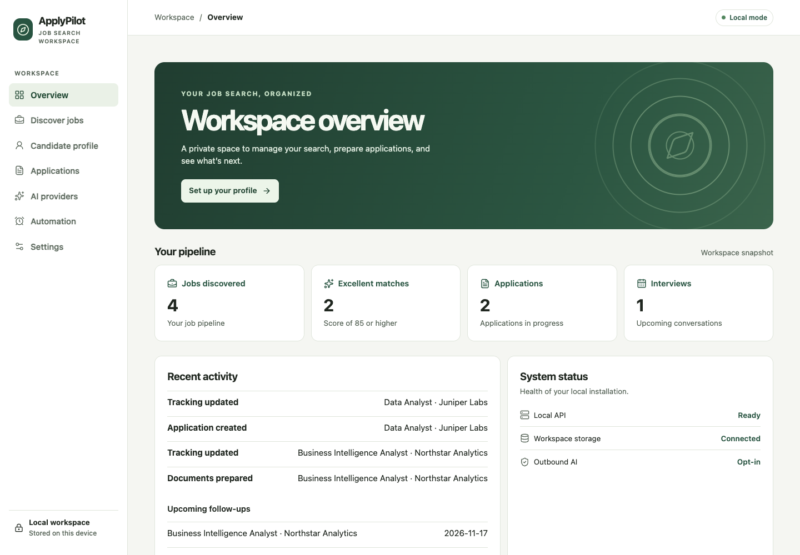
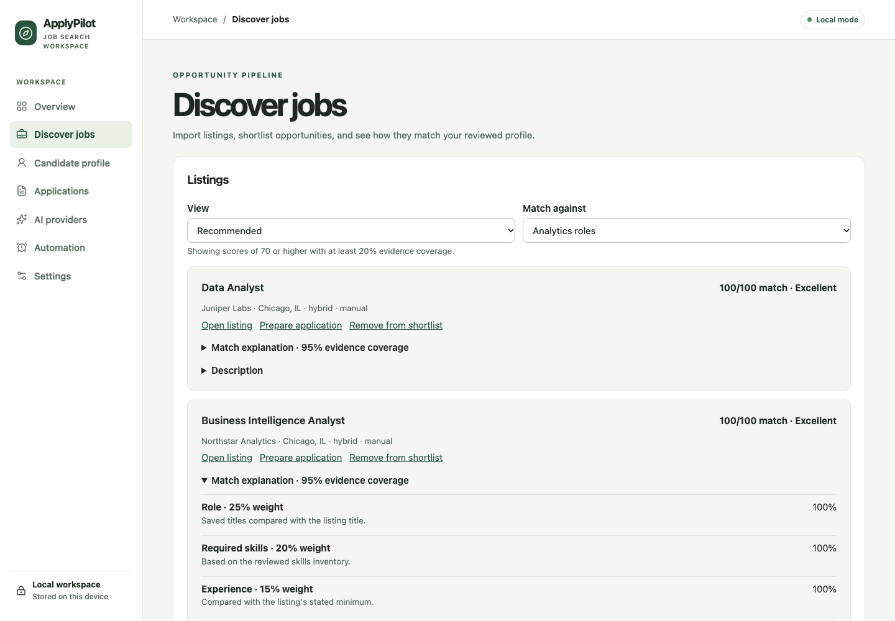
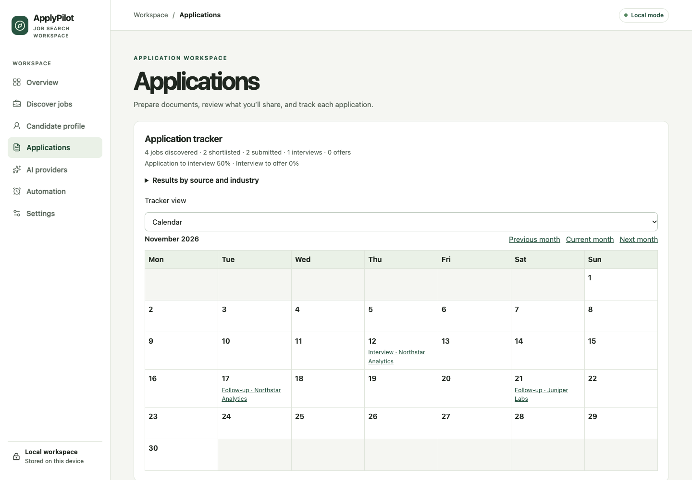

# ApplyPilot

[](https://github.com/arun2k00/applypilot/actions/workflows/ci.yml)
[](LICENSE)

**A local workspace for finding jobs, preparing applications, and tracking what happens next.**

Bring in a resume, review the extracted facts, and compare job listings against the background and preferences you choose. Prepare a tailored application package, submit it on the employer’s site, and track follow-ups in one place. The core workflow runs locally with SQLite. Optional model providers require explicit consent before receiving candidate data.



## Features

| Workflow | What you can do |
| --- | --- |
| Candidate profile | Import text-based PDF and DOCX resumes, review suggested fields, keep the originals, and browse profile revisions. |
| Job discovery | Paste listings and alerts or import authorized RSS feeds. Save search preferences, set scoring weights, and see which evidence supports each match. |
| Application preparation | Compare and edit tailored resumes, draft cover letters and screening answers, and export PDF or DOCX files. Approve each package before using it. |
| Tracking | Record submissions, interviews, offers, and follow-ups. Switch between a table, board, and monthly calendar. |
| Automation | Schedule authorized feeds and get in-app reminders or opt-in desktop alerts while ApplyPilot is open. |
| Data management | Export a SQLite backup, restore it offline, or delete candidate records from the active workspace. |

## Quick start

Install Docker with the Compose plugin, then run these commands from a terminal:

```sh
git clone https://github.com/arun2k00/applypilot.git
cd applypilot
docker compose up -d --build --wait
```

Open [localhost:3000](http://localhost:3000/). Start in **Candidate profile**, then add a listing in **Discover jobs**. Use **Prepare application** to open the document and tracking workspace for that listing.

Compose stores workspace data in a named volume and publishes the web interface on loopback. For native setup, an external macOS drive, configuration options, and recovery commands, see the [installation and operations guide](docs/usage.md).

## Screenshots

All screenshots use sample records.

<details>
<summary>Job discovery and match explanations</summary>



</details>

<details>
<summary>Monthly application calendar</summary>



</details>

## Project status

ApplyPilot is in active development. The local workflow covers profile review, discovery, document preparation, and application tracking. You submit applications on the employer’s site. Live provider compatibility, employer-site form assistance, and the complete platform matrix are tracked in the [roadmap](docs/architecture.md#implemented-workflows-and-remaining-release-gates).

## Documentation

- [Installation, providers, backups, and troubleshooting](docs/usage.md)
- [Architecture and roadmap](docs/architecture.md)
- [Changelog](CHANGELOG.md)
- [Release checklist](docs/release.md)

Contributions are welcome. See [Contributing](CONTRIBUTING.md), the [Code of Conduct](CODE_OF_CONDUCT.md), and the [Security Policy](SECURITY.md). ApplyPilot is available under the [MIT License](LICENSE).
